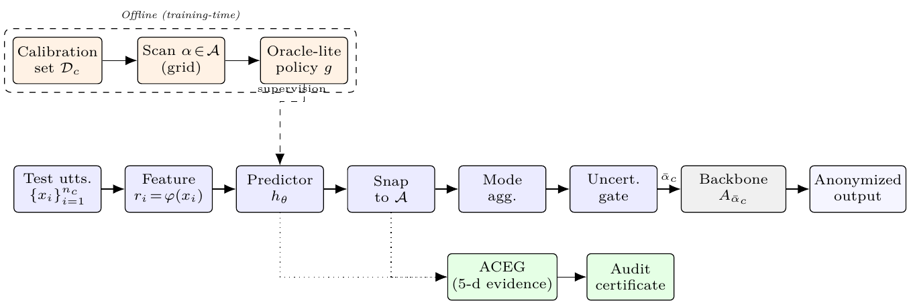
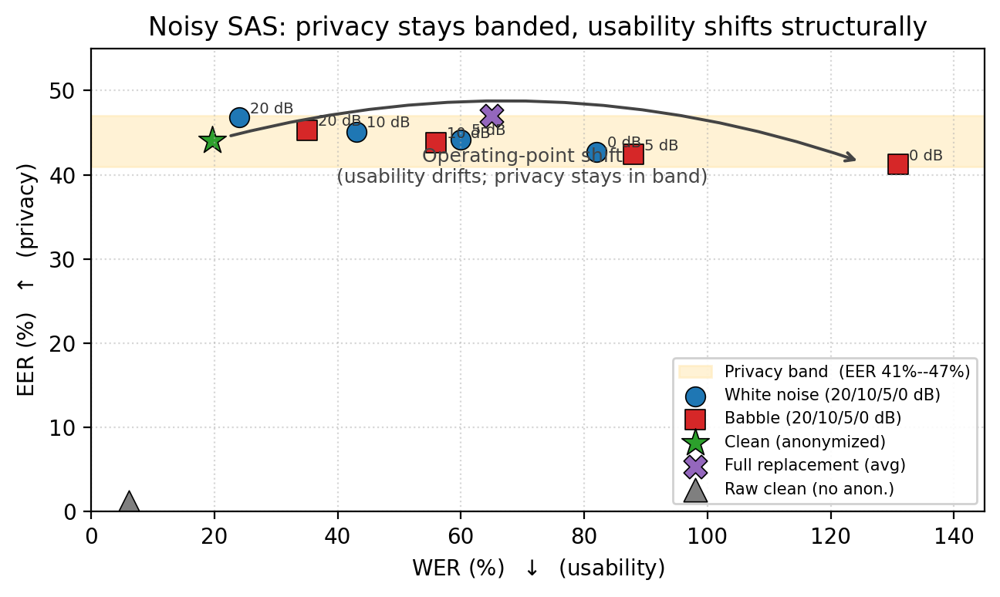
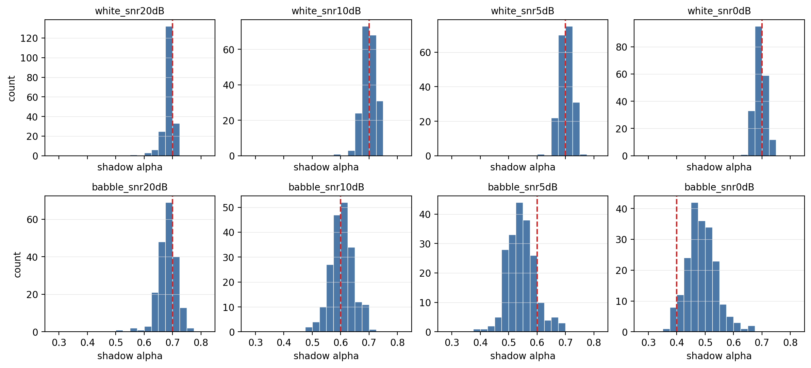

# Condition-Level Operating-Point Recovery for Noisy Speaker Anonymization

Reference implementation and evaluation protocol for **Condition-Aggregated State
Recovery (CASR)**, a lightweight runtime control layer for noisy speaker
anonymization.

<p align="center">
  
</p>

## Overview

Speaker anonymization must hide speaker identity while preserving intelligibility.
Under background noise, a strength calibrated on clean speech may no longer provide
an appropriate privacy--utility trade-off. Our experiments show that noise mainly
shifts the utility side of the operating point rather than causing a systematic
privacy collapse.

CASR formulates this problem as **operating-point recovery under a hidden noise
condition**. It freezes the anonymization backbone, requires no test-time noise
labels, and:

1. predicts utterance-level anonymization strength from lightweight acoustic cues;
2. aggregates the predictions into a stable condition-level decision;
3. applies the calibrated strength to the unchanged anonymization backbone; and
4. emits a read-only Alpha-Control Evidence Gate (ACEG) record for auditing decision
   consistency and uncertainty.

CASR is therefore a complement to existing SSL-based speaker anonymization
backbones, not a replacement for them.

## Main results

- CASR recovers the offline reference strength in **7 of 8** canonical noise
  conditions without using noise labels at test time.
- Its maximum panel-mean gap from the offline reference policy is **0.31 percentage
  points** across EER, WER, and CER.
- The controller adds approximately **5.20 ms per utterance**, about **1.0%** of the
  backbone inference time in our setup.
- ACEG records control consistency and uncertainty without changing the selected
  strength.

<p align="center">
  
</p>

<p align="center"><em>
Across the canonical noise panel, privacy remains within a relatively narrow EER
band while WER deteriorates substantially as noise becomes more severe.
</em></p>

## Condition-level recovery

The released controller predicts a strength for each utterance and then aggregates
the snapped predictions at condition level. The distributions below show why
aggregation is useful: most conditions concentrate near the offline reference
strength, while difficult babble conditions exhibit wider uncertainty.

<p align="center">
  
</p>

The dashed red line marks the offline reference strength for each condition. CASR
recovers the same strength in seven conditions; the single mismatch occurs for
`babble_snr5dB`.

## Released components

- `src/casr/features.py`: eight acoustic descriptors used in the ablation study.
- `src/casr/controller.py`: quadratic predictor, condition aggregation,
  uncertainty calibration, and ACEG.
- `src/casr/protocol.py`: deterministic 20-speaker/200-utterance LibriSpeech
  protocol with 900 positive and 900 negative verification trials.
- `src/casr/noise.py`: deterministic additive-noise mixing at a target SNR.
- `src/casr/metrics.py` and `src/casr/bootstrap.py`: EER, WER/CER, and paired
  bootstrap helpers.
- `configs/`: released CASR policy, offline reference strengths, and protocol
  metadata.
- `artifacts/canonical_utterance_predictions.json`: 1,600 derived prediction
  records for checking condition-level recovery without distributing speech.

The repository intentionally excludes speech corpora, noise recordings, model
weights, generated audio, and third-party anonymization implementations.

## Installation

```bash
python -m venv .venv
source .venv/bin/activate
python -m pip install -e .
```

The reference controller requires Python 3.10 or later and NumPy. Audio passed to
the released policy must be mono, 16-bit PCM, and sampled at 16 kHz.

## Reproduce the canonical decisions

```bash
python scripts/recover_canonical.py
```

This command reads the released utterance-level predictions, applies the same
condition-level control path, and prints the recovered strength and ACEG metadata
for all eight canonical conditions.

To inspect one condition:

```bash
casr recover \
  --policy configs/casr_policy.json \
  --predictions artifacts/canonical_utterance_predictions.json \
  --condition babble_snr5dB
```

## Build the evaluation protocol

Download LibriSpeech separately and point the command to the directory containing
`SPEAKERS.TXT` and `test-clean/`:

```bash
casr build-protocol \
  --data-root /path/to/LibriSpeech \
  --output outputs/eval_protocol \
  --seed 2026
```

The generated protocol contains 20 speakers, 10 utterances per speaker, 900
same-speaker trials, and 900 different-speaker trials. See
[`docs/EVALUATION_PROTOCOL.md`](docs/EVALUATION_PROTOCOL.md) for the complete
evaluation definition.

## Scope and limitations

This is the paper's control-layer and protocol release, not a standalone SSL-SAS
backbone. End-to-end waveform anonymization requires a compatible backbone that
exposes anonymization strength `alpha`. The reported policy was calibrated on white
and babble noise at 20, 10, 5, and 0 dB; performance on unseen noise types should
not be interpreted as guaranteed generalization.

## Data and licensing notice

No corpus audio is redistributed. Obtain [LibriSpeech](https://www.openslr.org/12/)
and [MUSAN](https://www.openslr.org/17/) from OpenSLR under CC BY 4.0. Obtain
[DEMAND](https://zenodo.org/records/1227121) from its official Zenodo record under
CC BY-SA 3.0.

The repository currently does not assign an open-source software license. Until a
license is selected, reuse rights are not granted beyond viewing and evaluating the
published material.

## Citation

The paper citation will be added after publication.
