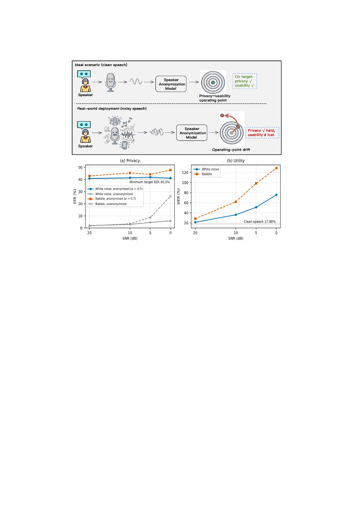
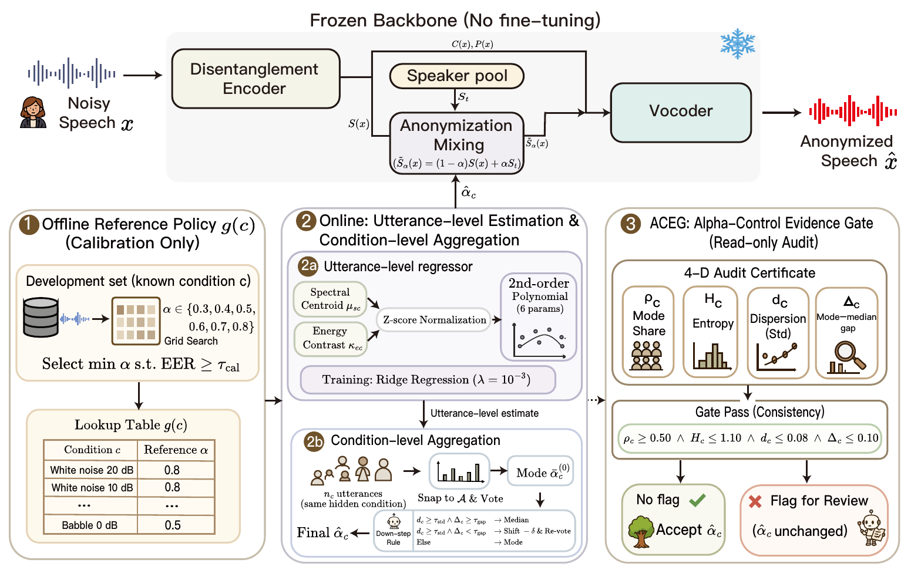

# Condition-Level Operating-Point Recovery for Noisy Speaker Anonymization

Reference implementation and evaluation protocol for **Condition-Aggregated State
Recovery (CASR)**, a lightweight control layer that selects the anonymization
strength of a frozen speaker-anonymization backbone for noisy speech.

## Problem

Speaker anonymization rewrites the speaker identity in speech while keeping the
linguistic content intelligible. The anonymization strength `alpha` sets how much of
the speaker representation is rewritten. Under background noise, privacy measured
by the equal error rate (EER) largely holds, utility measured by the word error rate
(WER) drops, and the smallest strength that meets the minimum target EER changes
with the noise condition. A strength fixed on clean speech therefore either falls
below the privacy requirement or gives up utility.

<p align="center">
  
</p>

## Method

CASR keeps the backbone frozen and does not read noise labels when it selects a
strength. It has three components.

1. **Offline calibration.** On a development set whose speakers do not overlap with
   any evaluation speaker, the reference policy `g(c)` is the smallest candidate
   strength whose EER meets the calibration threshold `tau_cal = tau + m`
   (`tau = 40.5%`, margin `m = 3.2` points). A six-parameter second-order ridge
   regressor on two acoustic features (spectral centroid and energy contrast) learns
   `g(c)` from single utterances.
2. **Online recovery.** For a batch recorded under one condition, CASR estimates a
   strength for each utterance, snaps the estimates to the candidate grid
   `{0.3, ..., 0.8}`, takes the mode, and applies a three-branch down-step rule
   when the estimates are dispersed. The batch strength goes directly to the
   backbone.
3. **Alpha-Control Evidence Gate (ACEG).** A read-only record of whether the
   utterance-level estimates of the batch agree. ACEG never changes the strength.
   It reflects consistency, not correctness.

<p align="center">
  
</p>

## Main results

Eight canonical conditions (white and babble noise at 20, 10, 5, and 0 dB), lazy-informed
attacker, ECAPA-TDNN verifier, Whisper-base ASR. WER is averaged over three decoding
seeds. The difference is CASR minus the global fixed strength selected on the same
development set, with 95% speaker-cluster bootstrap confidence intervals.

| Evaluation panel | Conditions meeting the minimum target EER | WER of CASR (%) | WER difference vs. fixed strength 0.8 (points) |
|---|---:|---:|---:|
| LibriSpeech test-clean, 20 speakers | 8/8 | 61.92 | -2.35 [-3.12, -1.63] |
| LibriSpeech test-clean, 40 speakers | 8/8 | 63.59 | -0.79 [-1.53, -0.08] |
| VoicePrivacy speaker set, 29 speakers | 8/8 | 64.67 | -0.95 [-1.77, -0.14] |

The control layer takes about 5.19 ms per utterance, against about 505 ms for the
backbone. The batch strength is available once the whole batch has arrived.

## Scope

- CASR assumes that the utterances of a batch share one noise condition.
  Condition changes within a batch shift the decision.
- The development set must cover the noise types met at deployment. On noise types
  absent from the development set, CASR can underestimate the required strength,
  and ACEG does not reliably flag this.
- The backbone must offer at least one candidate strength that meets the minimum
  target EER.

## Repository contents

- `src/casr/controller.py`: utterance-level regression, snapping, mode aggregation,
  down-step rule (`conservative_shift` in the code), and ACEG.
- `src/casr/features.py`: acoustic feature extraction from 16 kHz mono audio.
- `src/casr/protocol.py`: deterministic 20-speaker/200-utterance protocol with 900
  positive and 900 negative verification trials.
- `src/casr/noise.py`: additive-noise mixing at a target SNR.
- `src/casr/metrics.py`, `src/casr/bootstrap.py`: EER, WER/CER, and bootstrap helpers.
- `configs/casr_policy.json`: the released regressor fitted on the development set,
  the reference policy, the margin, and the down-step thresholds.
- `configs/offline_reference_policy.json`: the reference policy `g(c)`.
- `configs/evaluation_protocol.json`: panels, development set, metrics, and statistics.
- `artifacts/canonical_utterance_predictions.json`: features and predictions of the
  1,600 utterances of the 20-speaker main panel, so that the batch decisions can be
  checked without distributing speech.
- `docs/`: evaluation protocol, calibration, and implementation notes.

The repository does not include speech corpora, noise recordings, model weights,
generated audio, third-party anonymization backbones, or the full experiment code.

## Installation

```bash
python -m venv .venv
source .venv/bin/activate
python -m pip install -e .
```

Python 3.10 or later and NumPy are required. Audio must be mono, 16-bit PCM, 16 kHz.

## Reproduce the batch decisions

```bash
python scripts/recover_canonical.py
```

The script reads the released utterance-level predictions, applies the released
policy, and prints the selected strength, the branch of the down-step rule, and the
ACEG record for each of the eight canonical conditions of the 20-speaker main panel.

To inspect one condition:

```bash
casr recover \
  --policy configs/casr_policy.json \
  --predictions artifacts/canonical_utterance_predictions.json \
  --condition babble_snr5dB
```

## Build the evaluation protocol

Download LibriSpeech separately and point the command to the directory that contains
`SPEAKERS.TXT` and `test-clean/`:

```bash
casr build-protocol --data-root /path/to/LibriSpeech --output outputs/eval_protocol --seed 2026
```

See [`docs/EVALUATION_PROTOCOL.md`](docs/EVALUATION_PROTOCOL.md) for the full definition.

## Data and licensing notice

No corpus audio is redistributed. Obtain [LibriSpeech](https://www.openslr.org/12/)
and [MUSAN](https://www.openslr.org/17/) from OpenSLR under CC BY 4.0, and
[DEMAND](https://zenodo.org/records/1227121) from its Zenodo record under CC BY-SA 3.0.

The repository does not yet assign an open-source software license. Until one is
selected, no reuse rights are granted beyond viewing and evaluating the material.

## Citation

The citation will be added after publication.
